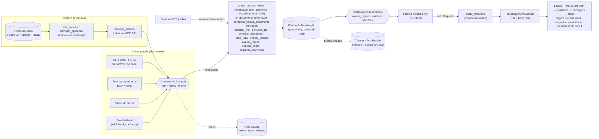

# Arquitetura do Laudo Vivo

Fluxo do regional: **fiscalização de investimento pecuário** (compra de bovinos + cerca/curral), MCR 2-7 (Res.
CMN 5.267/2025). O detalhe de cada passo, com os nomes do código, está em
[`fluxo_do_agente.md`](fluxo_do_agente.md); aqui ficam as peças, as fronteiras entre elas e **por que** cada
fronteira existe.

## Fronteiras de responsabilidade (e por quê)

| Peça | Faz | Não faz | Por quê |
|---|---|---|---|
| **LLM e VLM (a IA)** | lê o papel (VLM: DANFE e GTA por foto, depois validados pelas regras), entende a fala (extrai alegações com ponteiro, JSON Schema), conduz a conversa e pode chamar as checagens da etapa; quando não chama a óbvia, o plano mínimo determinístico chama | calcular número, definir status, assinar, emitir o laudo, mandar para assinatura | tudo que vira prova sai de código determinístico, e a fala do modelo passa pela política (POL-05 e POL-09) antes de chegar à fiscal; com o mesmo pipeline sem LLM, o recall e o falso "verificado" do golden set são os mesmos ([`resultados.md`](resultados.md)); o papel do LLM está na coleta (papel e fala) |
| **VLM** (`ler_documento_foto`, `classificar_foto`) | transcreve o papel; rotula a cena da foto | aceitar o que leu | todo campo lido passa por DV, somas e coerência; sem 2 leituras concordando não há valor. A foto prova a estrutura só se a classe for a do item; o VLM nunca dá divergência |
| **Residual** (`completar_leitura_documento`) | pede à fiscal só os campos que a foto não validou e revalida com as mesmas regras | completar ou "corrigir" sozinho | o que a foto não prova, a fiscal lê no papel; a máquina só aceita o que fecha (DV da chave, quantidade × unitário = total, machos + fêmeas = total) |
| **Ferramentas** | calculam (contagem, conciliação, geofence, NDVI, lotação, regras) | conversar | determinísticas, idempotentes por hash da entrada, `Envelope` padronizado; erro vira `Envelope.falha`, nunca valor inventado |
| **Verificador** | atribui o status de cada campo pelo rulebook | ler o que o LLM escreveu | quem conversa não verifica (Q-05): o status não depende da fala do modelo |
| **Política** | autoriza ou nega cada ação (default-deny por etapa), confere a fala do LLM (POL-05 números, POL-09 semântica e ação afirmada) | decidir conteúdo | regras estreitas e citáveis; cada decisão vira span `policy.decision` |
| **Humano** | declara independência, atesta a obra, justifica divergência, emite o rascunho, assina | — | MCR 2-7-15/16 e a responsabilidade da IF; o agente nunca assina (POL-03) |

## Estados (FSM)

`BRIEFING → COLETA ⇄ CHECAGEM → CONCILIACAO → REVISAO → RASCUNHO → ASSINATURA → SELADO`

Lacuna ou pendência devolve para `COLETA` com pedido específico ("filme o lote passando pelo corredor", "foto
da cerca de dentro da gleba", "leia os 12 últimos dígitos da chave de acesso"). `RASCUNHO`, `ASSINATURA` e
`SELADO` só por ação humana.

## Ferramentas (contratos em `src/laudo/contracts.py`)

| Ferramenta | Faz | Quem chama | Abstém/pendente quando |
|---|---|---|---|
| `triar_carteira`, `carregar_operacao` | prioridade de verificação (lotação implícita, sobreposição de glebas, NDVI, rebanho municipal) | carteira; dependência do plano | sem polígono ou dado |
| `planejar_metodo` | método por item e requisitos pela regra | LLM ou plano | regra ambígua |
| `contar_bovinos_video` | detector + rastreador + linha de contagem, com intervalo e quadros-chave | LLM ou plano | oclusão, confiança, intervalo largo |
| `integridade_foto`, `geofence` | EXIF, GPS, horário, duplicata, tela; ponto × gleba | LLM ou plano | sem EXIF/GPS; GPS impreciso na borda |
| `classificar_foto` | VLM: a foto mostra a estrutura do item (cerca, curral)? k ≤ 3 com abstenção | plano (não oferecida ao LLM) | concordância < 2/3, classe "outro" ou de outro item |
| `ler_documento_foto` | VLM lê DANFE/GTA do papel; consenso entre leituras; validação determinística de cada campo | plano | campo crítico sem validação → pedido do residual |
| `completar_leitura_documento` | revalida a leitura com o que a fiscal leu (só os campos pedidos) | turno de residual (sem LLM) | não fecha DV/somas → novo pedido (até 3); depois, pedir o XML |
| `conciliar_nfe`, `conciliar_gta` | documento (XML, JSON ou foto validada) × item, × NF-e, × operação | LLM ou plano | documento ilegível ou requisito ausente |
| `conciliar_alegacoes` | o que a fiscal disse × a evidência (contagem, NF-e, projeto) | plano | sem evidência para confrontar |
| `serie_ndvi`, `checar_lotacao` | série Sentinel-2 da gleba com metadados do item 4; lotação × município | LLM | nuvem; sem área |
| `avaliar_regras`, `explicar_regra` | rulebook → campos e bloqueios; citação literal | verificador; LLM | — |
| `emitir_rascunho`, `registrar_ocorrencia` | laudo HTML/JSON com hash raiz (ou `BLOQUEADO_POLITICA`); ocorrência na cadeia | comando humano; guardas | — |

O **servidor MCP** (`src/laudo/mcp_server.py`, `scripts/py.sh -m laudo.mcp_server`) expõe as mesmas
ferramentas do `REGISTRO` a qualquer cliente MCP (stdio, JSON-RPC 2.0); política, verificador e assinatura
humana ficam no condutor, de propósito: quem orquestra a fiscalização não é o cliente.

## Operação e LGPD

- **Trace por fiscalização** (OpenTelemetry em JSONL): cada turno, chamada ao LLM (tokens, tempo de GPU),
  ferramenta e decisão da política; o laudo linka o span de cada checagem.
- **Custo medido no trace** (`audit/custo.py`, `scripts/custo_fiscalizacao.py`): tokens e tempo de GPU por
  fiscalização e o equivalente em nuvem e em energia.
- **Cofre e expurgo** (`audit/cofre.py`, `scripts/expurgo_lgpd.py`): uma chave por fiscalização cifra os
  brutos com dado pessoal; apagar a chave expurga sem quebrar a cadeia de hash (que guarda só sha256 e
  metadados).
- **Replay**: requisições e respostas do LLM e do VLM gravadas viram fixtures; a demo roda sem GPU e acusa
  quando o prompt ou o contexto mudou.
