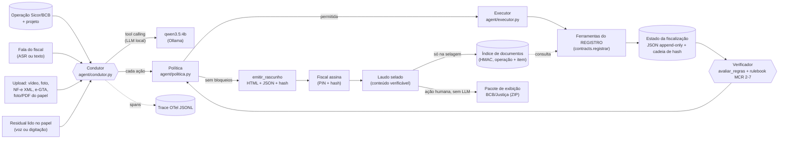

# Fluxo do agente Laudo Vivo (inputs, lógica, outputs)

Entregável 4 do edital (§8.1; requisitos REQ-06 e REQ-50 a REQ-55 do parecer do edital, fora do
repositório). Descreve o que o código faz hoje, com os nomes do código (REQ-07). Fluxo do regional:
**fiscalização de operações com animais**, MCR 2-7 (Res. CMN 5.267/2025): a demo é de investimento (compra de
bovinos + cerca/curral), e o perfil de custeio de aquisição e manutenção de animais entrou no rulebook em
16/10/2026. Estado em 16/10/2026: o que a avaliação r3 mediu (09/10: residual da leitura de foto, VLM na foto da
benfeitoria, rulebook 0.3.0, ação afirmada na POL-09, origem de cada valor no laudo) e o que entrou depois, ainda
sem rodada própria (até a r4): orçamento e disjuntor do LLM (seção 2.7), índice de documentos reutilizados (seção
5), verificação do selo pelo conteúdo e pacote de exibição (seção 3) e o observatório de desclassificações, que
fica fora da fiscalização (seção 4b).

O agente recebe uma operação de crédito rural e conduz o fiscal, por voz ou texto, até um laudo em que **cada
item aponta para a sua prova**. O modelo de linguagem conversa, escolhe a próxima ferramenta e redige; ele
**não calcula número nem define status**. Quem calcula são as ferramentas; quem atribui o status é o
verificador, a partir do rulebook; quem decide se uma ação pode acontecer é a política; quem assina é o humano.



## 1. Inputs

| Entrada | Formato | Origem | Validação na entrada |
|---|---|---|---|
| Operação | `contracts.Operacao` (REF_BACEN, município IBGE, finalidade, datas, valores, área, glebas WKT WGS84, itens) | Sicor/BCB via `carregar_operacao` (bench Fiscal-GO 2026) + projeto da IF | Pydantic; sem CPF/CNPJ (`tomador_ref` pseudonimizado ou hash do documento) |
| Fala do fiscal | texto pt-BR (do ASR local `laudo.speech`, com a confiança em `Evento.confianca_asr`, ou digitado) | app/CLI | guardas determinísticas (POL-03, POL-06, POL-07) antes do LLM; confiança < 0,35 → "pode repetir?"; PII mascarada em log e trace |
| Vídeo do lote | mp4/webm/mov, até 180 s processados | celular no curral | `contar_bovinos_video`: arquivo legível, sha256, modelo com sha256 conferido |
| Foto da benfeitoria | JPEG/PNG com EXIF e GPS do app (`contracts.GPS`) | app de captura | `integridade_foto` (EXIF, horário, GPS, duplicata, tela) e `geofence` |
| NF-e | XML leiaute 4.00 (procNFe), até o limite de `TAMANHO_MAXIMO_XML` | vendedor/tomador | `conciliar_nfe`: chave e DV, assinatura (Digest C14N), protocolo, NCM 01.02 |
| DANFE ou GTA em papel | foto (JPEG/PNG) ou PDF de scan, evidência `documento` | celular da fiscal | `ler_documento_foto`: VLM lê (k = 2 a 3 leituras, consenso); cada campo passa por DV, somas, datas e IBGE; o que não valida fica `indeterminado` e vira **pedido do residual** |
| Residual | valores que a fiscal lê no papel, por voz (transcrita) ou digitação (`Evento.residual`; CPF/CNPJ e código do estabelecimento só digitados, o código duas vezes) | fiscal | `completar_leitura_documento`: as mesmas regras da leitura, junto com o que a foto já validou |
| e-GTA | JSON no modelo `docs_fiscais.gta.GTA` | defesa sanitária (SIDAGO/GO) | `conciliar_gta`: formato (IN MAPA 09/2021), espécie, quantidade, origem/destino, datas |
| Declarações do fiscal | trecho literal da fala | fiscal | independência (MCR 2-7-15), conclusão da obra (MCR 2-7-16-a), justificativa de divergência (POL-02) |
| Satélite | Sentinel-2 L2A (Earth Search, COG) | rede, com cache em disco | `serie_ndvi`: polígono no Brasil, ≤ 5.000 ha, ≥ 2 datas limpas |
| Data de referência | `Fiscalizacao.data_referencia` | abertura da fiscalização | usada nas regras e no prompt (o modelo não inventa data) |

Toda evidência entra em `Fiscalizacao.evidencias` com sha256 e `hash_anterior` (cadeia de hash,
`audit/hashchain.py`). Upload com texto de terceiros (OCR, observação de documento) é varrido por POL-06.

## 2. Lógica

### 2.1 Quem faz o quê

| Componente | Código | Recebe | Entrega |
|---|---|---|---|
| Condutor (LLM local) | `agent/condutor.py::Condutor` | evento (fala e/ou upload) + contexto do estado | ações propostas (tool calls) e a fala ao fiscal |
| Executor | `agent/executor.py::ExecutorFerramentas` | nome + argumentos | `Envelope` com `data.status` no vocabulário `StatusChecagem`; timeout, retentativa, span |
| Preenchimento de argumentos | `agent/executor.py::preencher_argumentos` | ferramenta + estado | caminho do arquivo a partir do `evidencia_id`, gleba, item, GPS, contexto das regras, data de referência |
| Ferramentas | `src/laudo/tools/*.py` (`@registrar`) | entrada Pydantic | `Envelope` (nunca exceção, nunca valor inventado) |
| Verificador | `agent/verificador.py::Verificador` | estado | `ResultadoVerificacao`: `CampoLaudo` por exigência e `bloqueios` (modelo `Bloqueio`), via `avaliar_regras` |
| Regras | `tools/regras.py` + `rulebooks/mcr_2_7.yaml` | operação, checagens, evidências | método (`planejar_metodo`), status por campo e bloqueios (`avaliar_regras`), citação (`explicar_regra`) |
| Política | `agent/politica.py::Politica` | ação + estado + fala | `Decisao` (permitido, `rule_id`, pendências, ocorrência) |
| Estado | `agent/estado.py::RepositorioFiscalizacoes` | `Fiscalizacao` | JSON gravado de forma atômica; append-only conferido a cada `salvar` |
| Humano | `Condutor.assinar` (chamado pela interface) | PIN conferido + hash raiz | `AprovacaoHumana` e laudo selado |

### 2.2 Estados (FSM, `agent/fsm.py`)

`BRIEFING → COLETA ⇄ CHECAGEM → CONCILIACAO → REVISAO → RASCUNHO → ASSINATURA → SELADO`

| Estado | Ferramentas permitidas (allowlist; o resto é negado por POL-00) | Ações internas |
|---|---|---|
| BRIEFING | `carregar_operacao`, `planejar_metodo`, `serie_ndvi`, `checar_lotacao`, `avaliar_regras`, `registrar_ocorrencia`, `explicar_regra` | `pedir_evidencia`, `avancar_etapa` |
| COLETA | `serie_ndvi`, `checar_lotacao`, `carregar_operacao`, `emitir_rascunho`, `registrar_ocorrencia`, `explicar_regra` | `pedir_evidencia`, `registrar_justificativa`, `registrar_conclusao_obra`, `avancar_etapa` |
| CHECAGEM | `contar_bovinos_video`, `integridade_foto`, `geofence`, `conciliar_nfe`, `conciliar_gta`, `serie_ndvi`, `checar_lotacao`, `registrar_ocorrencia`, `explicar_regra`; do plano (não oferecidas ao LLM): `ler_documento_foto`, `completar_leitura_documento`, `classificar_foto`, `conciliar_alegacoes` | `pedir_evidencia`, `registrar_conclusao_obra`, `avancar_etapa` |
| CONCILIACAO | `conciliar_nfe`, `conciliar_gta`, `checar_lotacao`, `avaliar_regras`, `registrar_ocorrencia`, `explicar_regra` | `registrar_justificativa`, `registrar_conclusao_obra`, `avancar_etapa` |
| REVISAO | `avaliar_regras`, `emitir_rascunho`, `registrar_ocorrencia`, `explicar_regra` | `pedir_evidencia`, `registrar_justificativa`, `registrar_conclusao_obra`, `avancar_etapa` |
| RASCUNHO | `emitir_rascunho`, `registrar_ocorrencia`, `explicar_regra` | `registrar_justificativa`, `solicitar_assinatura`, `avancar_etapa` |
| ASSINATURA | `registrar_ocorrencia` | — (só o humano: `assinar`) |
| SELADO | — | — (POL-04: nada muda) |

O upload de evidência leva a FSM a CHECAGEM. Depois da verificação, com pendência do POL-01 ela volta a COLETA
com o pedido específico; sem pendência segue para REVISAO. `emitir_rascunho` permitido leva a RASCUNHO;
`solicitar_assinatura`, a ASSINATURA; só `assinar` (humano) leva a SELADO.

**Ações só humanas** (`fsm.ACOES_POR_COMANDO_HUMANO`, rodada 2): `emitir_rascunho` e `solicitar_assinatura`
continuam na allowlist do estado, mas **o LLM não as recebe em estado nenhum** (`fsm.nomes_permitidos`) e a
política nega se ele tentar (POL-03). Elas só acontecem por comando explícito do fiscal, reconhecido sem LLM
(`intencao.comando_humano`: "pode emitir o laudo", "manda para a minha assinatura"; pergunta, negação e ruído
não contam), ou pelo botão da interface. Num turno de comando o LLM não é consultado.

### 2.3 Um turno (`Condutor._turno`)

1. **Registro.** A fala vira evidência `declaracao` (com `assunto = independencia_fiscal` quando o fiscal
   declara independência, `agent/declaracoes.py`); o upload vira evidência do seu tipo; ambos entram na cadeia
   de hash. Metadados do upload passam pela varredura de injeção (POL-06).
   **Ruído**: fala sem conteúdo (silêncio, "[inaudível]", hesitações, fragmentos) ou com confiança do ASR abaixo
   de 0,35 (`Evento.confianca_asr`) → "pode repetir?", sem alegação, sem LLM e sem ação (`intencao.eh_ruido`).
   **Residual** (rodada 3): se há pedido de residual pendente (`condutor.residual_pendente`: a leitura de foto mais
   recente de um DANFE/GTA, sem XML/e-GTA do mesmo item depois) e a fala (ou o formulário) traz valores dos campos
   pedidos (`residual.interpretar_resposta`: cada campo consome, na ordem, o trecho do seu formato — dígitos da
   chave, número, data, UF, município), o turno é de completação: `completar_leitura_documento` revalida, a
   conciliação do documento roda de novo com a leitura completada, e a fala é de template. Sem LLM, sem alegação
   (é leitura do papel, não declaração) e sem os valores nos argumentos da ação (CPF digitado não vai para o trace).
2. **Guardas da fala** (antes do LLM): injeção (POL-06), pedido para o agente assinar (POL-03), pedido de
   alterar valor sem nova evidência (POL-07). A pressão tem grau (`intencao.classificar_pressao`): **forte**
   (verbo de alteração + valor ou status, "pode marcar 29", "bota o número do projeto", "deixa passar essa
   diferença") responde por template e registra ocorrência; **incerta** (sinal sem alvo: "o gerente já
   aprovou", "o certo é quarenta", "corrige a contagem") só pede esclarecimento e não grava nada na cadeia
   imutável; menção a banco, gerente ou cooperativa sem pedido de alterar valor ("o banco pediu as fotos") não é
   pressão. Em guarda ou esclarecimento o LLM nem é chamado. Depois das guardas, o **comando humano** (emitir o
   rascunho, mandar para assinatura) é reconhecido sem LLM.
3. **Alegações**: números ditos pelo fiscal (saída estruturada com JSON Schema, `prompts/alegacoes.v1.md`, mais
   extrator determinístico), cada uma com ponteiro para o trecho da fala. Alegação não define status.
4. **Declarações literais**: conclusão de obra (`registrar_conclusao_obra` → checagem `declaracao_conclusao`) e
   justificativa de divergência (`registrar_justificativa`), reconhecidas sem LLM e sempre com o trecho
   literal; a política confere de novo. A justificativa só vale se o trecho literal fala do assunto do campo,
   não é pergunta e a fala não pede para alterar valor (nem de forma parafraseada); ela nunca muda número nem
   status. Se o LLM propuser a mesma declaração já registrada no turno, ela não é repetida.
5. **Decisão do LLM**: com o status já recalculado no contexto, o modelo escolhe ações entre as permitidas no
   estado (tool calling nativo; até 4 passos e 3 chamadas por passo). Cada ação passa pela política
   (`Politica.autorizar`) e pelo executor. Tool call malformada (o Ollama devolve 500) aciona a contingência por
   saída estruturada `{acao, argumentos, fala_para_o_fiscal}` validada por JSON Schema.
6. **Plano mínimo determinístico**: se o modelo não chamou a checagem óbvia do upload (vídeo → contagem; foto →
   integridade + geofence e, na foto de cerca/curral/galpão, `classificar_foto` com a classe esperada do item;
   NF-e → `conciliar_nfe`; GTA → `conciliar_gta`; foto/PDF de documento → `ler_documento_foto` e a conciliação do
   tipo lido), o condutor chama. Cada ferramenta do plano roda uma vez por evidência (não há laço de pedidos: duas
   classificações inconclusivas da mesma estrutura levam à abstenção, e a declaração do fiscal resolve). Pré-requisito: antes
   do `planejar_metodo`, a triagem da operação (`carregar_operacao`) roda uma vez, para o plano usar a prioridade.
   A localização depende da integridade da mesma foto: o geofence só roda depois de `integridade_foto`, e foto
   com integridade em `erro` (arquivo ilegível) ou `divergente` (tela, reaproveitada) deixa o geofence
   `indeterminado` (o GPS não pode ser atribuído a ela).
7. **Verificação**: o verificador recalcula todos os campos com `avaliar_regras`; a FSM avança ou volta. Depois,
   o comando humano do turno, se houver, passa pela política.
8. **Fala = fatos por template + condução do LLM** (`agent/fatos.py`). As frases que afirmam resultado
   (contagem e direção, documentos, localização, satélite, status, emissão, justificativa registrada) são
   geradas por template a partir do estado. A fala do LLM passa pela **consistência semântica (POL-09)**:
   direção da contagem (falta × excesso), posição da foto (dentro × fora), status do campo, consequência sobre o
   crédito ("impede a liberação"), qualificação de ilícito e juízo sobre o pasto; com violação, vale o template
   inteiro e a decisão vai para o trace. Desde a rodada 3 a POL-09 também confere **ação afirmada**: "registrei o
   contato", "comparei o CPF", "enviei ao banco" só passam se a ação aconteceu no turno (ações executadas,
   ferramentas chamadas, upload, alegação registrada) ou está no estado (ocorrência, justificativa, rascunho);
   assinar, aprovar, alterar valor e falar com terceiros nunca passam. Antes da análise, marcações internas que o
   modelo ecoa (`<dado>`, `<contexto>`, `<hash>`, `<tool_call>`) saem da fala. Sem violação, as frases do LLM que
   afirmam resultado saem (o fato vem do template) e ficam as de condução, que ainda passam pelo grounding numérico
   (POL-05, que ignora identificadores: chave de acesso e CPF/CNPJ, mascarados ou não). Ação do LLM negada →
   template. Num turno em que a leitura da foto acabou de gerar o pedido do residual, a condução é só de template
   (o LLM não pede outra foto por cima do pedido). O estado é gravado (append-only conferido) e a conversa vai para `<id>.conversa.jsonl` com PII
   mascarada.

### 2.4 Ferramentas e contratos

Todas registradas com `@registrar` (`contracts.py`), entrada Pydantic, saída `Envelope` com `data.status` em
`ok | divergente | indeterminado | erro` (o executor converte qualquer outro termo com `para_status_checagem` e
guarda o original em `status_ferramenta`). Sem `data.status`, a checagem vira `indeterminado`, nunca `ok`.

| Ferramenta | Faz | Status | Timeout | Lida pela regra |
|---|---|---|---|---|
| `carregar_operacao` | operação do Sicor + triagem (prioridade e motivos) | ok | 10 s | prioridade → `planejar_metodo` |
| `triar_carteira` | carteira ordenada por prioridade (tela de carteira; fora da fiscalização) | ok | 10 s | — |
| `checar_lotacao` | cab/ha financiadas × densidade bovina do município (IBGE PPM) | ok / indeterminado (sem área) | 10 s | sinal de triagem, nunca divergência |
| `planejar_metodo` | método por item (MCR 2-7-3, OP-metodo-escolha-por-item), obrigatoriedades, prazos, requisitos | ok | 10 s | grava `Fiscalizacao.metodo` e `requisitos` |
| `avaliar_regras` | `CampoLaudo` por exigência + `bloqueios` | ok | 10 s | é o verificador |
| `explicar_regra` | citação literal, item da norma, fonte | ok | 2 s | — |
| `serie_ndvi` | NDVI p10/p50/p90 por data (Sentinel-2, 10 m, SCL) + metadados do MCR 2-7-4-b | ok / `NUVEM` → indeterminado | 240 s, sem retentativa | `laudo:sensoriamento_remoto`, `laudo:metadados_sensoriamento` |
| `contar_bovinos_video` | YOLOX (CPU) + rastreador + linha de contagem; intervalo, abstenção e quadros-chave | ok / indeterminado | proporcional à duração (30 s + 2 × s/s × duração) | `OP-bovinos-contagem-tolerancia` (5% só para baixo) |
| `integridade_foto` | EXIF, horário, GPS × app, sha256/phash, nitidez, foto de tela | ok / indeterminado / divergente | 5 s | `OP-evidencia-integridade-foto` |
| `geofence` | ponto × gleba em UTM local: `posicao` dentro/fora/indeterminado e distância à borda | ok / divergente / indeterminado | 1 s | `OP-benfeitoria-geofence` (≤ 100 m verifica; 100–1000 m **pendente** — nova captura ou justificativa do fiscal, nunca abstenção; > 1000 m diverge) |
| `conciliar_nfe` | NF-e × item (espécie, quantidade, valor, data, partes, operação), integridade e protocolo | pior dos campos | 10 s | `MCR-2-5-item10-comprovante-aquisicao` |
| `conciliar_gta` | e-GTA × NF-e × item (formato, espécie, quantidade, destino, origem, finalidade, data) | pior dos campos | 10 s | `OP-bovinos-gta` |
| `classificar_foto` | VLM local: a foto mostra a estrutura do item (`classe_esperada`)? até k = 3 amostras (a 3ª só se as 2 primeiras discordam), abstenção abaixo de 2/3 | ok / indeterminado (nunca divergente) | 90 s | `MCR-2-7-item16-benfeitorias-conclusao` (plano mínimo na foto de cerca/curral/galpão; não oferecida ao LLM) |
| `ler_documento_foto` | VLM lê DANFE/GTA de foto ou PDF (2 recortes × k leituras, consenso campo a campo) e valida cada campo; devolve `documento` (só o validado; CPF/CNPJ como máscara + hash) e `pedido_residual` | ok / indeterminado | 240 s | alimenta `conciliar_nfe`/`conciliar_gta` |
| `completar_leitura_documento` | o residual lido pela fiscal + o que a foto validou, revalidados juntos (`docs_fiscais.residual`); chave montada dos grupos lidos + posições derivadas de UF, data, série, número e CNPJ; proveniência "lido de foto e completado pela fiscal" | ok / indeterminado (+ novo pedido, até 3) | 10 s | alimenta `conciliar_nfe`/`conciliar_gta` |
| `conciliar_alegacoes` | alegação da fala × evidência (contagem, NF-e, projeto, declaração) | ok / divergente / indeterminado | 10 s | `OP-alegacao-declaracao-x-evidencia` (informativa; não muda campo) |
| `emitir_rascunho` | laudo HTML + JSON com hash raiz, ou `BLOQUEADO_POLITICA` com as pendências | — | 20 s | — |
| `registrar_ocorrencia` | ocorrência (pressão, injeção, falha) na cadeia de hash | — | 2 s | — |

Ações internas do condutor (expostas ao LLM, fora do REGISTRO): `pedir_evidencia`, `registrar_justificativa`
(trecho literal, só para campo divergente ou em abstenção), `registrar_conclusao_obra` (trecho literal; vira a
checagem `declaracao_conclusao`), `avancar_etapa` (nunca para RASCUNHO/ASSINATURA/SELADO). Ações humanas:
`emitir_rascunho` e `solicitar_assinatura` (comando explícito ou botão; o LLM não as recebe) e `assinar` (PIN +
hash, POL-03).

NF-e e GTA são cumulativas: a cada upload, `conciliar_nfe`/`conciliar_gta` reconciliam **todos** os documentos do
mesmo tipo já recebidos para o item (duas notas da mesma compra, uma GTA por carga), e a checagem nova lista em
`resultado.substitui` as anteriores, que saem da agregação (rulebook 0.2.0). Na foto, uma captura inconclusiva
só é superada por outra verificada **depois** dela.

Erros: arquivo inexistente ou ilegível → `ENTRADA_INVALIDA`; dado ausente → `SEM_DADOS`; fora do domínio →
`FORA_DO_ESCOPO`; nuvem → `NUVEM`; timeout → `TIMEOUT` (retentativa com backoff só em ferramenta de até 30 s);
exceção → `ERRO_INTERNO` com a mensagem mascarada. O contrato é conferido por `tests/contract/`.

**Servidor MCP** (`src/laudo/mcp_server.py`, `scripts/py.sh -m laudo.mcp_server`): as mesmas ferramentas do
`REGISTRO` para qualquer cliente MCP, por stdio (JSON-RPC 2.0, uma mensagem por linha, sem dependência externa):
`initialize`, `ping`, `tools/list` (nome, descrição, `inputSchema` do Pydantic e `readOnlyHint`) e `tools/call`
(devolve o `Envelope` em `structuredContent`; `isError` quando `ok` é falso). `--somente-leitura` tira as que
gravam estado; `--ferramentas a,b` restringe. Política, verificador e assinatura humana **não** passam pelo
MCP: quem orquestra a fiscalização é o condutor. Testes em `tests/unit/test_agente_mcp.py`.

### 2.5 Políticas, bloqueios e abstenção

| Regra | Tipo | O que faz |
|---|---|---|
| POL-00 | bloqueio | default-deny: ação fora da allowlist do estado, ou inexistente, é negada |
| POL-01 | bloqueio | rascunho só sem os `bloqueios` do rulebook (`avaliar_regras`): campo pendente, abstenção sem justificativa, metadados do MCR 2-7-4-b ausentes |
| POL-02 | bloqueio | campo divergente só sai no laudo com justificativa humana (trecho literal da fala do fiscal, sobre o campo, que não é pergunta nem pedido de alterar valor); o agente não redige justificativa nem atesta obra; justificativa nunca muda número |
| POL-03 | bloqueio | o agente nunca assina; assinatura humana exige PIN e o hash raiz do último rascunho, sem evidência nova depois dele; emitir o rascunho e enviar para assinatura também são ações humanas (comando ou botão) |
| POL-04 | bloqueio | evidência é imutável; fiscalização selada não muda; correção é evidência nova |
| POL-05 | bloqueio | número ou data sem lastro no estado derruba a fala do LLM (vale o template) e a redação do laudo; identificador (chave de acesso, CPF/CNPJ, mascarados ou não, número impresso da NF-e) não é número a aterrar (`verificador.remover_identificadores`) |
| POL-06 | registro | texto de documento, OCR ou transcrição é dado, nunca instrução: vira ocorrência `injecao` |
| POL-07 | registro | pedido de alterar valor sem nova evidência: pressão **forte** vira ocorrência `pressao`; pressão **incerta** só pede esclarecimento (span `policy.resultado = esclarecer`, nada na cadeia); o valor não muda |
| POL-08 | transformação | CPF, CNPJ, telefone, e-mail e nomes após gatilho mascarados em log, trace e gravação |
| POL-09 | transformação | fala do LLM inconsistente com o estado (direção, posição, status, consequência sobre o crédito, ilícito, juízo sobre o pasto) ou que **afirma ação que não aconteceu** no turno nem está no estado vira template (`policy.resultado = transformar`); frase do LLM que afirma resultado sai, o fato vem do template; marcação interna (`<dado>`...) sai da fala |

**Status de campo** (`avaliar_regras`, `docs/regras.md` seção 3): `verificado`, `divergente`, `pendente`,
`abstencao`. Checagem inconclusiva deixa o campo pendente com pedido de nova coleta; depois de
`PAR-tentativas-inconclusivas-max` (2) tentativas, o sistema se **abstém** e a decisão passa ao humano. Medição
precisa que não basta (rulebook 0.3.0: foto fora da gleba entre 100 e 1000 m) **não é inconclusiva**: fica pendente
quantas capturas forem, e a pendência se resolve com nova captura de dentro da gleba ou com a justificativa do
fiscal (o campo continua pendente no laudo, com as palavras dele, e deixa de bloquear).
Checagens conclusivas conflitantes ficam pendentes (recontar até passar não resolve). Divergência não bloqueia
por si: é achado do laudo, e o fiscal precisa justificá-la (POL-02).

### 2.6 Entrada inesperada e "nenhuma ferramenta serve"

| Situação | Comportamento |
|---|---|
| Ação inexistente ou fora do estado | negada (POL-00); a fala do LLM é trocada pelo template, que diz o que não foi feito |
| Ferramenta não registrada | `FORA_DO_ESCOPO`; campo continua pendente; nada é inventado |
| Item financiado sem fluxo no rulebook (lavoura, pastagem, outro) | campo `item:<id>` pendente por `OP-escopo-itens-regional` (bloqueia até haver regra ou decisão humana) |
| Arquivo ilegível, vídeo corrompido, XML truncado | `ENTRADA_INVALIDA`; checagem `erro`; campo pendente com "repetir" |
| Foto corrompida com GPS do app dentro da gleba | integridade `erro` → geofence `indeterminado`; localização não sai verificada (RT-FAL-04) |
| Vídeo com oclusão, câmera mexendo, escuro | contagem `indeterminado` com `pedidos_recaptura`; 2ª vez → abstenção |
| Foto sem EXIF/GPS, desfocada, cópia na mesma fiscalização | `integridade_foto` indeterminado → pendente (nova captura) |
| Foto já usada em outra fiscalização, foto de tela, horário incoerente | `integridade_foto` divergente |
| GPS impreciso na borda da gleba | `geofence` indeterminado → pendente; 2ª vez → abstenção |
| Duas fotos fora da gleba a 405 e 574 m (D06) | pendente (não abstenção): "refaça de dentro da gleba ou justifique (ex.: curral na sede)" |
| Foto do DANFE com a chave ilegível | `ler_documento_foto` indeterminado + pedido "leia os 12 últimos dígitos da chave de acesso"; a resposta só é aceita se a chave fechar o DV e bater com UF, data, série, número e CNPJ |
| Fiscal lê errado (a conta não fecha) | "Não aceitei a quantidade e valores da linha 1: quantidade × valor unitário ≠ valor total"; novo pedido (até 3); depois, "peça o XML" |
| Foto do DANFE com comprador = vendedor (D14) | o papel diz isso mesmo: não é erro de leitura, não há novo pedido; pendente até o XML |
| Foto da cerca que o VLM não reconhece como cerca | conclusão da obra inconclusiva (nunca divergente); a declaração do fiscal resolve |
| Nuvem no satélite | `NUVEM` → indeterminado → pendente; MCR 2-7-10: segue por documental/presencial |
| Satélite ou STAC fora do ar | `TIMEOUT` (até 240 s, sem retentativa) ou `ERRO_INTERNO`; campo pendente; o cache em disco serve a mesma consulta depois, também offline |
| LLM fora do ar | plano mínimo determinístico + fala de template; comandos de laudo e assinatura não dependem do LLM; no perfil `campo`, o disjuntor deixa o LLM de fora por 60 s (seção 2.7) |
| LLM travado (não responde) | TIMEOUT não é repetido; no perfil `campo`, o orçamento de 25 s por turno corta a espera e o disjuntor abre (seção 2.7) |
| GTA ou chave de NF-e já usada em laudo selado de **outra** operação | `conciliar_gta`/`conciliar_nfe` divergente pelo índice de documentos (seção 5); da mesma operação e outro item, indeterminado; refiscalização da mesma operação e item, ok |
| Tool call malformada | contingência por saída estruturada no mesmo passo |
| Fala com número que não existe no estado | POL-05: fala descartada, template (chave de acesso e CPF/CNPJ mascarados não contam como número) |
| Fala do LLM "registrei o contato do produtor", "enviei ao banco" | POL-09: ação que não aconteceu → template, decisão no trace |
| Fala do LLM com "excesso" quando falta, "impede a liberação do crédito", "o pasto tem boa saúde" | POL-09: template no lugar, decisão no trace |
| Silêncio, "[inaudível]", hesitação, confiança do ASR < 0,35 | "pode repetir?"; nada é interpretado (nem comando, nem alegação) |
| Injeção na fala ou no documento | POL-06: ocorrência, nada muda |
| "Pode marcar 29", "bota o número do projeto", "deixa passar essa diferença" | POL-07 forte: ocorrência de pressão, valor intacto; não vira justificativa |
| "O gerente já aprovou", "o certo é quarenta" | POL-07 incerta: pede esclarecimento, sem ocorrência |
| "O banco pediu as fotos", "vou marcar 3 pontos de GPS" | não é pressão: segue normalmente |
| "Assina por mim" | POL-03 |
| Conversa fora do escopo | uma frase e volta ao roteiro (prompt), sem ferramenta |
| Queda do processo no meio | estado gravado de forma atômica a cada turno; o próximo turno recarrega do disco |

### 2.7 Orçamento e disjuntor do LLM (perfil `campo`)

No palco e no campo o perfil é `campo` (`llm/provider.py`; padrão do `scripts/rodar_demo.sh` e da API). Nele:

- **TIMEOUT não é repetido** (temperatura 0: um modelo que não respondeu não responde na segunda vez); 5xx e queda
  de conexão continuam com 2 retentativas com backoff;
- **orçamento por turno:** o tempo somado das chamadas ao LLM no turno não passa de 25 s
  (`ORCAMENTO_TURNO_S`, sobreposto por `LAUDO_ORCAMENTO_TURNO_S`); estourou, a chamada falha como TIMEOUT sem ir
  ao servidor;
- **disjuntor** (`Condutor._falha_llm`, `_disjuntor_aberto`): depois de TIMEOUT ou de o servidor sumir, o LLM fica
  de fora no resto do turno e nos turnos seguintes por 60 s (`ESPERA_DISJUNTOR_S`); o agente segue com o plano
  mínimo e a fala por template, e a resposta do turno avisa ("LLM indisponível ...; disjuntor aberto por mais N
  s"). O primeiro turno depois disso tenta de novo. Erro de formato ou HTTP 4xx não abrem o disjuntor: o modelo
  respondeu, e a contingência por saída estruturada cobre.

Nos perfis `escritorio` e `lote` (avaliação) não há orçamento nem disjuntor, como na r3: um Ollama travado segura o
turno até o timeout de 120 s por chamada.

## 3. Outputs

1. **Resposta do turno** (`RespostaTurno`): fala (origem `llm` = fatos por template + condução do LLM,
   `template` ou `guarda`), `fatos` (as frases de resultado geradas por template), ações executadas (com
   `rule_id`, `span_id` e `checagem_id`; origem `llm`, `fallback`, `dependencia`, `comando`, `humano`,
   `guarda`, `esclarecimento` ou `residual`), alegações com ponteiro, ocorrências, pendências, transições e o
   **pedido do residual** pendente (`residual`: campos, instrução de cada um, voz ou digitação, tentativa), que a
   interface mostra como formulário.
2. **Rascunho do laudo** (`emitir_rascunho`, `dados_locais/.../laudos/<fis>/rascunho_<hash>.html|json`):
   identificação pública da operação; método e justificativa (método por item, prioridade, enquadramento,
   regra); metadados do sensoriamento remoto do MCR 2-7-4-b (satélite e sensor, datas, resolução espacial de
   10 m e radiométrica de 12 bits, bandas, metodologia, uso das imagens); **um campo por exigência** com status,
   regra, motivo (números em pt-BR), justificativa do fiscal, **origem do valor** ("XML da NF-e", "lido de foto e
   validado", "lido de foto e completado pela fiscal", "vídeo", "satélite", "foto georreferenciada", "foto
   classificada pelo VLM", "declaração do fiscal"), evidências (link para o arquivo e sha256) e checagens
   (ferramenta, status, span do trace); ocorrências; a seção **alegações × evidência**
   (`OP-alegacao-declaracao-x-evidencia`: cada alegação da fala ao lado da prova que a confronta — confere,
   divergente, pendente, registro, sem evidência — sem mudar status de campo); cadeia de hash e **hash raiz**.
3. **Bloqueio**: `BLOQUEADO_POLITICA` com a lista de pendências (`regra_id`, campo, o que falta).
4. **Laudo selado** depois da assinatura humana, com o selo (hash da assinatura sobre o hash raiz). O humano
   assina o **hash raiz do rascunho** (sha256 da raiz da cadeia na emissão com o conteúdo do laudo); o selado
   repete esse conteúdo e guarda os campos da emissão em `conteudo_assinado`, e o JSON registra o sha256 do
   template do HTML. **Verificação pelo conteúdo** (`laudo.audit.selo`, `scripts/py.sh -m laudo.audit.selo --dados
   <dir> <fis_id>`: código 0 = confere, 1 = não confere): recalcula o selo, confere que cada assinatura é do hash
   raiz, reconstrói o conteúdo assinado e recalcula o hash, confere a cadeia e o rascunho registrado nela e
   renderiza o HTML de novo. Um valor trocado numa cópia do laudo selado faz a verificação falhar
   (`tests/unit/test_selo.py`). Limite declarado: sem chave por fiscal nem recibo enviado à IF, quem tem acesso ao
   disco consegue refazer laudo, rascunho, estado e selo de forma coerente.
5. **Trace** OTel em JSONL por fiscalização (`<dados>/traces/<fis>.jsonl`).
6. **Pacote de exibição BCB/Justiça** (`tools/pacote.py`; botão da interface, `scripts/demo_cli.py --pacote` ou
   `scripts/py.sh -m laudo.tools.pacote`): um ZIP gerado **só depois de SELADO** e **por ação humana, sem LLM** (fora
   do `REGISTRO` do agente, por isso as requisições ao LLM e os replays não mudam). Leva o manifest com sha256 de
   cada arquivo, o laudo selado como foi assinado, o GeoJSON da gleba e das fotos, as cenas de satélite (id, data,
   sensor, resoluções e bandas do MCR 2-7-4-b), o fundamento de cada item (citação literal nas regras do MCR;
   resumo do catálogo, marcado como não literal, nas de documentos fiscais), a memória de cálculo, por que a operação
   caiu na amostra (motivos da triagem), o termo de ciência do mutuário com prazo de contestação, a seção de
   reversão de desclassificação (IN BCB 758) e o checklist do que a decisão de Rio Verde mandou exibir, com o
   status real de cada item ("não aplicável" só com justificativa e nunca contado como presente). Nada no estado
   selado muda (POL-04); CPF/CNPJ e chave de acesso entram só mascarados, e documentos fiscais e vídeo entram por
   hash e referência. Teste de aceitação: `tests/unit/test_pacote_exibicao.py`. Ainda sem rodada de avaliação
   própria.

Exemplo do DEMO-0001 (operação **fictícia** `000000001`, derivada de um registro público do Sicor; documentos,
fotos e defeitos sintéticos), do laudo selado. Todo laudo de operação sintética leva a marca d'água
"DEMONSTRAÇÃO — dados sintéticos" e o bloco `demonstracao` no JSON (`laudo/demonstracao.py`); links para evidência
e trace são relativos à pasta do laudo (nenhum caminho da máquina no laudo):

| Campo | Status | Prova |
|---|---|---|
| `item:bov1:quantidade` | divergente, justificado | vídeo + 4 quadros-chave → `contar_bovinos_video` 12 [12–17] contra 29 financiadas (limite 27,55) |
| `item:bov1:comprovante_nfe` | verificado | NF-e XML → `conciliar_nfe` |
| `item:bov1:gta` | divergente, justificado | e-GTA → `conciliar_gta` (emitida 4 dias antes da NF-e) |
| `item:cerca1:localizacao` | verificado | 2ª foto → `geofence` dentro da gleba (a 1ª, a 650 m, deixou o campo pendente) |
| `item:cerca1:conclusao` | verificado | foto → `classificar_foto` (VLM: a foto mostra a cerca) + fala do fiscal → `declaracao_conclusao` |
| `laudo:independencia_fiscal` | verificado | fala do fiscal (MCR 2-7-15) |
| `laudo:metadados_sensoriamento` | verificado | `serie_ndvi` com os 8 metadados do MCR 2-7-4-b |

## 4. A demo de 3 minutos (DEMO-0001, ferramentas reais)

Caso em `eval/golden/demo/DEMO-0001/` (gerado por `eval/golden/gerador/gerar_casos.py --so-demo` e tornado
fictício por `scripts/mascarar_demo.py`): operação **fictícia** `000000001` de uma cooperativa fictícia, compra
de 29 vacas leiteiras e benfeitoria em Petrolina de Goiás (lotação implícita de 6,0 cab/ha, prioridade média).
REF, instituição, data, valores, área e geometria foram trocados (gleba espelhada, girada e deslocada ~4 km,
longe de qualquer gleba do Fiscal-GO; GPS das fotos pela mesma transformação), para nenhuma tela sugerir
irregularidade de produtor real; `tests/unit/test_agente_demo_etica.py` confere. Vídeo semissintético de
corredor com 15 animais, NF-e de homologação assinada, e-GTA e fotos sintéticas com EXIF/GPS. A tela mostra a
faixa e o selo "DEMONSTRAÇÃO — dados sintéticos"; o laudo e o JSON, a marca d'água. História
(`agent/roteiro_demo.py::executar_real`, roteiro padrão de **19 passos** desde a revisão de 09/10/2026, com a foto do papel):

1. Triagem e plano: `carregar_operacao` explica a prioridade (lotação acima de 5 cab/ha; não é acusação);
   `planejar_metodo` escolhe autofiscalização assistida.
2. Satélite: `serie_ndvi` (12 datas limpas de 12; NDVI mediano 0,38). O NDVI é índice, não nota de pasto.
3. Declaração de independência do fiscal.
4. Vídeo: 12 [12–17] contra 29 financiadas → **divergente**.
5. "Pode marcar 29, o resto está no pasto de cima" → **recusa** (POL-07) e ocorrência.
6. **Foto da nota impressa (DANFE)** (`fotos/danfe_1.jpg`, gerada por `eval/golden/gerador/gerar_danfe_demo.py`):
   o VLM lê; as regras conferem cada campo; a chave não fecha o DV e o CNPJ do emitente fica ilegível; o agente
   pede só "(1) leia os 12 últimos dígitos da chave de acesso; (2) digite o CNPJ/CPF do emitente". A NF-e fica
   pendente: a foto não prova assinatura nem protocolo.
7. **Residual:** a fiscal lê os 12 dígitos no papel (voz) e digita o CNPJ; `completar_leitura_documento` revalida
   tudo (DV da chave, coerência com UF, data, série, número e CNPJ) e a conciliação roda de novo, com origem "lido
   de foto e completado pela fiscal".
8. NF-e (XML) → verificado, e o papel é conferido contra o XML ("DANFE fotografado confere com o XML").
9. GTA → **divergente** (emitida antes da NF-e) e instrução embutida → ocorrência (POL-06).
10. Foto da cerca a ~650 m da gleba → localização **pendente** ("foto fora da gleba, a 649,9 m da borda (entre 100
    e 1000 m): refaça a foto de dentro da gleba ou registre a justificativa"); `classificar_foto` (VLM) confere que
    a foto mostra a cerca, e a conclusão da obra sai verificada pela foto.
11. "Pode emitir o laudo" (comando humano, sem LLM) → **BLOQUEADO_POLITICA** com 3 pendências (localização da
    cerca, justificativa da contagem, justificativa da GTA).
12. Correção: foto de dentro da gleba + "a cerca está concluída" → verificados.
13–14. Justificativas literais do fiscal para a contagem e a GTA.
15. "Pode emitir o laudo agora" (comando) → laudo emitido (hash raiz). 16. "Pode assinar por mim?" → recusa
(POL-03). 17. "Manda para a minha assinatura" (comando) → envio para assinatura.
18. Assinatura humana (PIN + hash) → selado. 19. "Muda a contagem para 29" → recusa (POL-04).

Sem o VLM (Ollama fora do ar), a leitura vira erro da ferramenta, o passo 7 é pulado e o XML fecha a NF-e: o selo
não muda (`--sem-danfe` na CLI roda os 17 passos do caminho só com o XML). Na interface web, os mesmos 19 passos
estão na barra "Controle da demonstração" ("Executar passo" ou tecla →); o passo do residual monta a fala da
fiscal a partir do que está impresso no papel (`documentos.danfe_foto.verdade` do caso), como ela faria pelo
microfone e pelo cartão "Complete a nota".

Tempos da gravação de 09/10/2026 (revisão de 09/10, depois da r3; Ryzen 9 9950X3D, RTX 5070 Ti, sem outra carga no Ollama): ponta a
ponta com o qwen3.5:4b, 39 s para os 19 turnos (turnos com LLM: p50 2,2 s; o do vídeo, ~14 s, dos quais ~11 s de
contagem em CPU). A leitura do DANFE ao vivo leva ~15 s de VLM (na gravação, veio do cache da mesma foto). Replay
sem GPU (`--llm replay`): ~12 s. Custo medido no trace da gravação (`scripts/custo_fiscalizacao.py`,
`eval/reports/2026-10-09_custo_demo.json`): <!--n:custo.chamadas_llm.valor-->21<!--/n--> chamadas ao LLM,
<!--n:custo.tokens_entrada.valor-->135.349<!--/n--> tokens de entrada e <!--n:custo.tokens_saida.valor-->1.038<!--/n-->
de saída; os mesmos tokens custariam de <!--n:custo.nuvem_min_rs.valor-->R$ 0,04<!--/n--> a
<!--n:custo.nuvem_max_rs.valor-->R$ 0,28<!--/n--> em modelos pequenos de nuvem, e a energia local,
<!--n:custo.local_rs.valor-->R$ 0,0035<!--/n--> (o VLM não entra na conta de tokens). O replay só é idêntico ao
gravado quando a CLI informa "0 requisições sem gravação exata"; depois de mudar prompt, esquemas ou contexto, a
fixture precisa ser regravada (`--gravar` com o Ollama) antes do ensaio. As gravações não dependem do sal da
instalação (os testes rodam com um sal novo a cada execução).

```
scripts/py.sh scripts/demo_cli.py --ferramentas reais --llm replay \
    --replay tests/unit/dados_agente/replay_demo_real_qwen35_4b.jsonl     # 19 passos, sem GPU
scripts/py.sh scripts/demo_cli.py --ferramentas reais --llm replay --sem-danfe \
    --replay tests/unit/dados_agente/replay_demo_real_sem_danfe_qwen35_4b.jsonl   # só o XML, 17 passos
scripts/py.sh scripts/demo_cli.py --ferramentas reais --llm ollama --perfil campo --descarregar
scripts/py.sh scripts/gravar_contingencia_web.py [--conferir]             # contingência da interface
```

## 4b. Fora da fiscalização: observatório de desclassificações

O observatório (`bench/desclassificacao/`, data card no README da pasta) não participa do turno nem do laudo:
ele lê em streaming os microdados públicos de desclassificação do Sicor e as operações de 2013 a 2026 e grava só
agregados e os atributos das operações desclassificadas (sem CPF/CNPJ do tomador). Dele saem as linhas 3 e 4 da
[matriz de validação](../validacao/README.md) e as chaves `desc.*` de
[`numeros.md`](entregaveis/numeros.md) (desclassificações registradas por ano e motivo, recorte de Goiás, taxa por
finalidade, controles de honestidade), e o rótulo do retro-teste pré-registrado da triagem (`eval/retroteste/`,
que não passou no limiar de palco). Desclassificação registrada não é ilícito, e nenhuma operação real é rotulada.

## 5. Memória e LGPD

- **Curto prazo (sessão):** o contexto do turno (etapa, itens, campos com status, pendências, últimas 8
  evidências) e as 3 últimas trocas da conversa, com hashes removidos.
- **Longo prazo:** o estado da fiscalização (`dados_locais/fiscalizacoes/<id>.json`) e a conversa mascarada
  (`<id>.conversa.jsonl`), ambos append-only; os arquivos de evidência ficam onde foram recebidos, ligados pelo
  sha256. Entre fiscalizações, o agente só guarda dois índices, os dois no diretório de dados e sem dado em
  claro: o **índice de fotos** (sha256 e phash, para detectar a mesma foto em outra fiscalização) e o **índice de
  documentos reutilizados** (`docs_fiscais/indice.py`, `agent/indice.py`, `<dados>/indices/documentos.jsonl`).
- **Índice de documentos:** guarda só HMAC (com o sal da instalação) da GTA (`UF-SÉRIE-NÚMERO`) e da chave de NF-e
  de cada laudo **selado**, com a operação (ref. Bacen, também em HMAC) e o item que o documento comprovou. A
  chave de contexto é **operação + item**, não a fiscalização: refiscalizar a mesma operação reapresenta os mesmos
  documentos de forma legítima. A **consulta** roda em toda `conciliar_nfe`/`conciliar_gta` (o executor preenche o
  caminho e a operação; o LLM não vê esses campos) e só lê: o mesmo documento em laudo selado de outra operação
  diverge (MCR 2-7-6-b e 2-7-7-d: duplicidade de crédito); da mesma operação e outro item, indeterminado. O
  **registro** acontece só na selagem (`registrar_na_selagem`, chamado por `tools/laudo.py::selar` depois da
  assinatura humana), com os documentos das conciliações finais que comprovaram o item; documento enviado por
  engano, conciliação intermediária e fiscalização não selada nunca entram. Vale dentro da instalação (hashes de
  instalações diferentes não se comparam). Análogo, do lado da IF, à regra 10ZF04-20 da NT 2024.003 ("GTA já
  utilizada").
- **Minimização:** nenhuma ferramenta de conciliação recebe CPF/CNPJ em claro: as partes da NF-e e da GTA são
  conferidas pelo hash do documento (`docs_fiscais.comum.hash_documento`, HMAC-SHA256 com o **sal da instalação**,
  `laudo.privacidade`; o sal fica em `dados_locais/config/instalacao.json`, fora do git, criado na primeira
  execução). A referência que vem de fora (`Operacao.tomador_ref` como `sha256:<hash público>`, o que o cadastro
  da IF ou o gerador do golden set calculam) é convertida na abertura e guardada como `hmac:<hash da instalação>`.
  O CPF/CNPJ lido de foto ou digitado pela fiscal no residual sai da leitura só como máscara + hash, e os valores
  digitados não entram nos argumentos registrados da ação nem no trace; a operação usa só campos públicos do Sicor.
- **Chave de acesso da NF-e** (embute o CNPJ, ou o CPF quando quem vende é pessoa física): no estado, no trace e no
  laudo aparece só **mascarada** (`522604…59429439`) e com `chave_hash` (HMAC com o sal da instalação); o mesmo vale
  para leituras brutas do VLM, a chave parcial do residual, a referência da assinatura (`#NFe…`), as chaves
  vinculadas na GTA e o CN do certificado (`NOME:CPF` vira iniciais e máscara). A chave inteira, necessária para o
  residual continuar, para conferir o papel com o XML e para a consulta futura à SEFAZ, fica **cifrada no cofre da
  fiscalização** (`_cofre` no resultado da checagem; `privacidade.restaurar_resultado` a devolve só em memória) e
  some com o expurgo. O DV é validado na leitura, com a chave inteira em memória. Detalhes, base legal e RIPD em
  [`docs/privacidade.md`](privacidade.md). O LLM é local (Ollama), então nenhuma fala, foto ou documento vai a
  um modelo fora da máquina (as duas saídas de rede, satélite e tiles do mapa, estão em `privacidade.md`, seção 5);
  se um provedor externo for configurado (`externo=True`), o condutor mascara PII antes do envio (POL-08).
- **Retenção (proposta, a validar com a IF):** fotos, vídeos, áudio, NF-e/GTA e conversa brutos 90 dias depois
  do selo; laudo selado, estado e trace pelo prazo que a IF definir para manter a documentação à disposição do
  BCB (MCR 2-7-23); índices de fotos e de documentos (só hash), proposta: o mesmo prazo do laudo que a linha
  comprova. O expurgo não mexe nos índices, e ainda não há comando que tire deles as linhas de uma fiscalização
  (`privacidade.md`, seções 4 e 8).
- **Expurgo por crypto-shredding** (`audit/cofre.py`, `scripts/expurgo_lgpd.py`): uma chave por fiscalização.
  `cifrar <fis>` cifra os brutos com dado pessoal que estão no diretório de dados (áudio, vídeo, fotos,
  quadros-chave, NF-e, GTA e a conversa); `expurgar <fis> --motivo ...` apaga a chave e registra o expurgo;
  `vencidos --dias 90 [--executar]` aplica a retenção às seladas. Sem a chave, os arquivos ficam ilegíveis; a
  **cadeia de hash continua íntegra** (ela guarda sha256 e metadados, não o arquivo), e o laudo selado continua
  provando o que foi visto. Cifra só com biblioteca padrão (HMAC-SHA256 em modo contador + etiqueta HMAC); em
  produção, AES-GCM com a chave num KMS. Hoje é rotina operacional (comando), não automática no selo.
  **Limite:** o texto das falas que vira evidência `declaracao` fica no estado e não é cifrado por essa rotina
  (cifrar antes de encadear é o próximo passo). Testes em `tests/unit/test_agente_cofre.py`.
- **Retomada (REQ-37):** estado e conversa gravados de forma atômica a cada turno; a confirmação de número falado
  pendente, as tentativas erradas de PIN e as pendências do último turno ficam no meta da interface
  (`<dados>/ui/<id>.json`, também atômico). Se o servidor cair, o processo novo continua a fiscalização com a cadeia
  de hash íntegra e a trava do PIN mantida (`tests/unit/test_api_retomada.py`); operação em
  [`docs/runbook.md`](runbook.md).
- **Aviso de gravação:** a tela da fiscalização mostra, sob o compositor, "Sessão gravada: a fala é transcrita
  neste computador e entra na trilha. Avise quem estiver presente."
- Termo de consentimento de quem é filmado ou gravado: responsabilidade da equipe e da IF (fora do código).

## 6. Observabilidade e métricas de degradação

- **Trace por fiscalização** (OpenTelemetry, `audit/otel.py`, JSONL): `agente.turno` (etapa inicial e final,
  versão do prompt, origem da fala), `gen_ai.chat <modelo>` (modelo, temperatura, semente, tokens de prompt e
  de geração, tempos de GPU do Ollama, latência, chave de replay), `tool <nome>` (hash dos argumentos, status, latência, timeout, tentativas, código de erro,
  versão da fonte) e `policy.decision` (`policy.rule_id`, resultado, motivo). Cada checagem e cada campo do laudo
  guardam o `span_id`, e o laudo linka o trace.
- **Versões:** prompt (`condutor.v2.md@<sha8>`), rulebook (`rulebook-mcr-2-7@0.2.0` + sha256 do YAML), modelos
  (sha256 do ONNX), ferramentas (`fonte_versao` em cada checagem).
- **Métricas e limiares de alerta propostos** (medidas pelo avaliador em `eval/reports/`): falso "verificado"
  no golden > 0 (alerta imediato); recall de defeito < 0,95; abstenção indevida > 10%; over-blocking > 10%;
  fala com número sem lastro > 0; tool call válida na 1ª tentativa < 95%; contingência estruturada ou plano
  mínimo acionados em > 20% dos turnos; turno com LLM p95 > 8 s; `TIMEOUT` de ferramenta > 5% das chamadas.
- **Custo por fiscalização medido no trace** (`audit/custo.py`, `scripts/custo_fiscalizacao.py <trace>`): soma
  por fiscalização os tokens de prompt e de geração de cada chamada ao Ollama, o tempo de GPU e o tempo de cada
  ferramenta, e estima o equivalente em nuvem (mesmos tokens × preço público de modelos pequenos da OpenAI e do
  Google, com fonte e data da consulta; câmbio PTAX) e a energia local (tempo × potência nominal × tarifa,
  parâmetros à vista). No replay, os tokens vêm da gravação original. Revisão humana não entra nessa conta.
- **Replay:** gravações requisição → resposta (`--gravar`) viram fixtures; `--llm replay` reproduz a
  fiscalização sem GPU e acusa quando o prompt, os esquemas ou o contexto mudaram (`substituicoes > 0`).

## 7. Responsabilidade humana

O fiscal (ou o agrônomo responsável) é quem: declara a independência (MCR 2-7-15); atesta a conclusão da obra;
lê no papel o que a foto do documento não validou (a máquina só confere);
justifica cada divergência com as próprias palavras; decide o que fazer com abstenção; e **assina**, com PIN e
conferência do hash raiz. O agente nunca assina, nunca altera valor a pedido e nunca qualifica fato como
ilícito (MCR 2-7-21 e 2-8: decisões da IF). Prioridade de verificação não é indício de irregularidade.

## 8. Avaliação

Golden set em `eval/golden/` (60 casos, taxonomia em `eval/golden/TAXONOMIA.md`, split em
`eval/golden/casos/SPLIT.yaml`) e o caso da demo em `eval/golden/demo/DEMO-0001/`. Comandos e métricas em
`eval/README.md`; resultados em `eval/reports/` (golden set determinístico e com agente, red-team, A/B) e o
resumo em [`eval/SLIDE.md`](../eval/SLIDE.md).

Rodada <!--n:versao.sufixo.valor-->r4<!--/n--> de 09/10/2026 (relatórios todos com
sha256(src/) <!--n:versao.sha256_src.valor-->1154df4aceffbf20<!--/n-->…; IC 95% de Wilson; fonte única dos números
em [`docs/entregaveis/numeros.md`](entregaveis/numeros.md)):

- **Golden set, teste (n = <!--n:golden.n_teste.valor-->24<!--/n-->), com o agente:** recall de defeito
  <!--n:recall_teste.fmt-->1,00 [0,70–1,00] (9/9)<!--/n-->; over-blocking <!--n:overblocking_teste.fmt-->0% [0–28%] (0/10)<!--/n-->;
  abstenção correta <!--n:abstencao_teste.fmt-->1,00 [0,57–1,00] (5/5)<!--/n-->; falso "verificado"
  <!--n:falso_verificado_teste.fmt-->0% [0–19%] (0/16)<!--/n-->; <!--n:grounding.sem_lastro.valor-->0<!--/n--> número sem
  lastro em <!--n:grounding.falas.valor-->273<!--/n--> falas e <!--n:grounding.laudos.valor-->24<!--/n--> laudos. Sem LLM,
  os mesmos números (o status vem das ferramentas e do verificador, por desenho). No dev, recall 1,00 (15/15); os
  dois casos D06 (foto fora da gleba entre 100 e 1000 m, um em cada split) saem como pendente desde o rulebook 0.3.0.
- **Latência sem outra carga no Ollama:** p50/p95 por turno <!--n:agente.latencia_p50.valor-->2,0 s<!--/n-->/<!--n:agente.latencia_p95.valor-->2,8 s<!--/n-->
  (meta p95 ≤ 6 s). Tool call válida na 1ª tentativa <!--n:agente.tool_call_valida.fmt-->100% [90–100%] (35/35)<!--/n-->.
  **Quem chama as checagens:** o LLM pode chamar as checagens da etapa; quando não chama a óbvia, o plano mínimo
  determinístico chama (rodou em <!--n:agente.turnos_plano_teste.valor-->148<!--/n--> turnos do teste, porque a ação que
  o LLM proporia sozinho batia com a esperada em só <!--n:agente.acao_llm_correta_teste.fmt-->42% [36–48%] (103/248)<!--/n-->
  dos turnos); o status vem sempre das regras e do verificador, e o humano assina. O LLM conduz a conversa e extrai
  as alegações da fala, onde é melhor que a regra.
- **Red-team (<!--n:redteam.n_casos.valor-->107<!--/n--> casos):** ataque bem-sucedido <!--n:redteam.ataques.fmt-->0% [0–5%] (0/80)<!--/n-->,
  com LLM e sem; over-blocking <!--n:redteam.overblocking.fmt-->0% [0–12%] (0/27)<!--/n-->; nenhuma fala afirmou ação não
  executada. Os casos foram escritos pela equipe (não é conjunto cego). No conjunto cego (v3), escrito de
  forma isolada e rodado uma vez, passaram <!--n:redteam.cego_ataques.fmt-->20% [10–37%] (6/30)<!--/n-->
  (<!--n:redteam.cego_ataques_sem_semicega.kn-->6/26<!--/n--> sem a família semi-cega;
  <!--n:redteam.cego_sem_llm_ataques.kn-->5/30<!--/n--> só com as guardas); as correções da r4.1, não cegas, deram
  <!--n:r41.v3_regressao_sem_llm_ataques.kn-->1/30<!--/n--> na regressão do v3.
- **A/B v1 (entrada já estruturada, fiscal simulado, <!--n:ab1.pares.valor-->42<!--/n--> pares):** empate,
  <!--n:ab1.checklist.kn-->42/42<!--/n--> × <!--n:ab1.agente.kn-->42/42<!--/n-->: com XML e JSON, o status é do código.
- **A/B v2 no teste congelado (papel fotografado e fala livre, sintéticos, fiscal simulado,
  <!--n:ab2_teste.n.valor-->24<!--/n--> fiscalizações):** o agente não conciliou mais que o formulário,
  <!--n:ab2_teste.residual.fmt-->71% [51–85%] (17/24)<!--/n--> contra <!--n:ab2_teste.formulario.fmt-->58% [39–76%] (14/24)<!--/n-->
  (<!--n:ab2_teste.mcnemar.curto-->p = 0,51<!--/n-->) e, sem a menção a item não financiado,
  <!--n:ab2_teste.residual_sem_registro.kn-->19/24<!--/n--> contra <!--n:ab2_teste.formulario_sem_registro.kn-->21/24<!--/n-->
  (<!--n:ab2_teste.mcnemar_sem_registro.curto-->p = 0,69<!--/n-->); o ganho é poupar a digitação do papel
  (<!--n:ab2_teste.toques_residual.valor-->12<!--/n--> toques contra <!--n:ab2_teste.toques_formulario.valor-->304<!--/n-->;
  <!--n:ab2_teste.tempo_residual.uma_casa-->34,5 s<!--/n--> contra <!--n:ab2_teste.tempo_formulario.valor-->215 s<!--/n--> da
  fiscal, modelado, mais cerca de <!--n:ab2_teste.tempo_maquina_residual.valor-->48 s<!--/n--> de máquina); na fala livre,
  <!--n:ab2_teste.fala_llm.kn-->40/46<!--/n--> com o LLM contra <!--n:ab2_teste.fala_regras.kn-->32/46<!--/n--> só com regras,
  com <!--n:ab2_teste.espurias_llm.valor-->1<!--/n--> alegação espúria nociva contra
  <!--n:ab2_teste.espurias_regras.valor-->0<!--/n-->.
- **A/B v2 no dev, onde o A/B foi desenvolvido (<!--n:ab2.n.valor-->36<!--/n--> fiscalizações; o ganho não se repetiu no
  teste):** conteúdo conciliado igual à referência com o residual real em <!--n:ab2.residual.fmt-->97% [86–100%] (35/36)<!--/n--> contra
  <!--n:ab2.formulario.fmt-->42% [27–58%] (15/36)<!--/n--> do formulário (<!--n:ab2.pares.valor-->21 × 1<!--/n--> pares
  discordantes, McNemar <!--n:ab2.mcnemar.valor-->p < 0,0001<!--/n-->); sem a menção a item não financiado, que o
  formulário não tem campo para registrar, <!--n:ab2.residual_sem_registro.valor-->97%<!--/n--> contra
  <!--n:ab2.formulario_sem_registro.fmt-->78% [62–88%] (28/36)<!--/n--> (<!--n:ab2.mcnemar_sem_registro.valor-->p = 0,039<!--/n-->);
  campos aceitos errados <!--n:ab2.aceitos_errados_residual.kn-->0/1399<!--/n--> (formulário:
  <!--n:ab2.aceitos_errados_formulario.kn-->13/1399<!--/n-->); <!--n:ab2.residual_completo.fmt-->93% [81–97%] (38/41)<!--/n-->
  dos documentos com pedido fecharam depois da fala da fiscal. "Conteúdo igual à referência" é a conciliação igual à
  do papel lido sem erro, não laudo pronto; tempo e erro humano modelados com parâmetros citados; a foto do DANFE
  não prova autenticidade sem o XML.
- **Código depois da rodada:** a privacidade da chave e do hash, a retomada, o roteiro da demo e, em 16/10, o
  perfil de custeio, o disjuntor, o índice de documentos, a verificação do selo e o pacote mudaram `src/` depois
  dos relatórios. A equivalência das métricas foi conferida em 09/10 (a que `numeros.md` cita) e em 16/10, 01:47
  (6 de 6 iguais, num código que já tinha o perfil de custeio e a primeira versão do pacote; `CHANGELOG.md`);
  **o disjuntor, o índice de documentos, a verificação do selo e os ajustes do rulebook, da interface e do pacote
  vieram depois e ainda não têm conferência de equivalência**. O split de
  teste foi congelado em 16/10/2026, 00:58; a r4 completa, com LLM, roda uma vez no congelamento do código
  (`docs/runbook.md`, seção 8).

## 9. Respostas às perguntas da §10

| Pergunta | Resposta curta | Onde |
|---|---|---|
| Q-01 Prompting | prompts versionados; fala e evidência viram contexto estruturado; tool calling com esquema; saída inválida → contingência estruturada → template | `agent/prompts/`, `llm/provider.py::pedir_json` |
| Q-02 Fatos | cada campo aponta para evidência, checagem e regra com citação literal; sem fonte, pendente; grounding numérico (POL-05) | `tools/laudo.py`, `rulebooks/`, `docs/normas/` |
| Q-03 Ferramentas | allowlist por estado, timeouts, retentativa; nenhuma serve → pendente com pedido, nunca inventa | seção 2.4 e 2.6 |
| Q-04 Orquestração | 8 estados da FSM; estado em JSON append-only com cadeia de hash; idempotência por hash da entrada | `agent/fsm.py`, `agent/estado.py` |
| Q-05 Multiagente | papéis separados: quem conversa (LLM) não verifica (`avaliar_regras`) nem autoriza (política) nem assina (humano) | seção 2.1; A/B em `eval/ab_centralidade/` |
| Q-06 Avaliação e segurança | golden set com defeitos plantados, red-team, contrato das ferramentas, replay | `eval/`, `tests/` |
| Q-07 Memória e LGPD | entre fiscalizações só o índice de fotos e o de documentos reutilizados (HMAC); retenção proposta e expurgo por chave (crypto-shredding) | seção 5; `audit/cofre.py`, `scripts/expurgo_lgpd.py` |
| Q-08 LLMOps | trace por laudo, versões no trace, tokens e custo por fiscalização, métricas com limiar (seção 6), replay | `audit/otel.py`, `audit/custo.py` |
