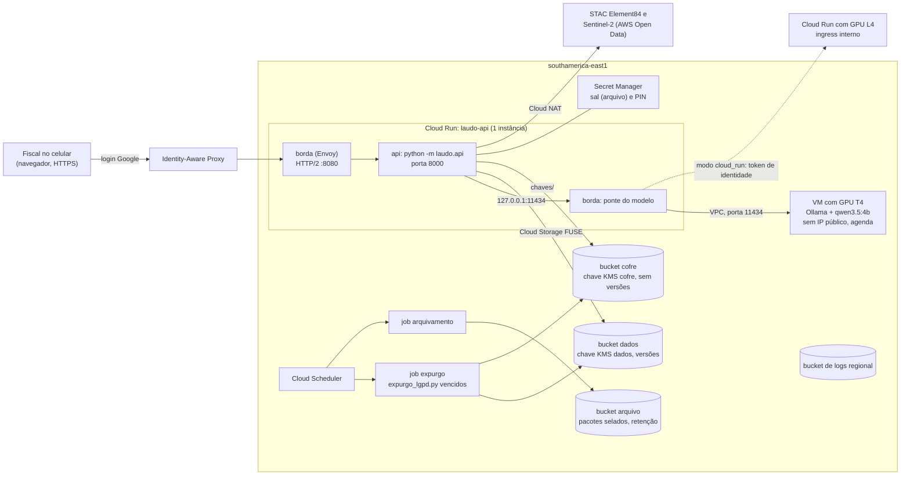

# Implantação gerenciada (GCP)

O Laudo Vivo tem duas formas de implantação, com o mesmo código, a mesma imagem e os mesmos controles: na
máquina da cooperativa ou da credenciada, com GPU própria, e gerenciada num projeto do Google Cloud da
instituição, descrita nesta pasta em Terraform. As duas estão lado a lado em
[`docs/implantacao.md`](../../docs/implantacao.md).

Na forma gerenciada, a API e a interface (`python -m laudo.api`) rodam no Cloud Run; os diretórios de dados
do produto viram buckets do Cloud Storage cifrados com chaves do Cloud KMS da instituição; o sal da instalação
e o PIN ficam no Secret Manager; e o modelo (`qwen3.5:4b` no Ollama) roda numa GPU do próprio projeto, só com
acesso interno. Nenhuma API de modelo de terceiros entra no caminho. Por padrão tudo fica em São Paulo
(`southamerica-east1`): evidências, laudos, chaves, segredos, logs e o servidor do modelo.

## Desenho



- **Borda.** O contêiner de entrada é um Envoy ([`modelos/borda.yaml.tftpl`](modelos/borda.yaml.tftpl)). Ele
  recebe o tráfego do Cloud Run em HTTP/2 de ponta a ponta, o que tira o limite de 32 MiB por requisição do
  HTTP/1 ([cotas do Cloud Run](https://docs.cloud.google.com/run/quotas)): o vídeo do lote (até 600 MB,
  `servico.LIMITE_UPLOAD_MB`) e o `pacote.zip` passam inteiros. Dentro da instância, ele também atende em
  `127.0.0.1:11434`, o endereço do Ollama que o condutor (`OLLAMA_HOST`) e a leitura de foto usam, e leva
  essas chamadas ao servidor do modelo. O Cloud Run só publica a porta da borda; a da API (8000) fica
  dentro da instância.
- **Dados.** Cada subpasta de `dados_locais/api` (fiscalizações, interface, traces, laudos, evidências,
  áudio, índices, gravações) é um volume do Cloud Storage FUSE montado do prefixo `api/<pasta>` do bucket de
  dados; `chaves/` vem do bucket do cofre. Os caminhos dentro do contêiner são os mesmos da máquina local
  (`--dados /dados/api`), e o código não muda.
- **Uma instância.** O estado fica em arquivo, com a cadeia de hash, e tem um escritor: a API roda com no
  máximo uma instância (`api_min_instancias` 0 ou 1). A escala é vertical (`api_cpu`, `api_memoria`).
- **Modelo.** `servidor_modelo` escolhe onde ele roda:

  | Modo | Onde | Acesso | Liga e desliga |
  |---|---|---|---|
  | `gce` (padrão) | VM N1 com NVIDIA T4 (16 GB) numa zona de `southamerica-east1` | IP interno; firewall só para a tag de rede da API | agenda (`gce_agenda`; padrão seg. a sáb., 6h às 20h) |
  | `cloud_run` | Cloud Run com NVIDIA L4 em `regiao_modelo` | ingress interno + `roles/run.invoker` só para a conta da API | escala a zero |
  | `nenhum` | sem GPU | — | a API usa a conversa gravada do caso `DEMO-0001` (`--llm replay`) |

  Em 17/10/2026, a [tabela de GPUs por zona do Compute Engine][gpu-zonas] listava N1+T4 nas três zonas de
  `southamerica-east1` e não listava L4 nessa região, e a [página de GPU do Cloud Run][gpu-run] não incluía
  `southamerica-east1` entre as regiões com GPU. Por isso o padrão é a VM em São Paulo. As duas listas mudam:
  confira antes de aplicar. No modo `cloud_run` fora do Brasil, a fala e a foto do documento passam pela
  região escolhida durante a inferência (o serviço de modelo não grava o conteúdo); avalie com o encarregado
  de dados (LGPD, art. 33).

[gpu-zonas]: https://docs.cloud.google.com/compute/docs/gpus/gpu-regions-zones
[gpu-run]: https://docs.cloud.google.com/run/docs/configuring/services/gpu

## Arquivos

| Arquivo | O que cria |
|---|---|
| [`versions.tf`](versions.tf), [`providers.tf`](providers.tf) | Terraform ≥ 1.11, provedores `google` 8.x e `random`; labels padrão |
| [`variables.tf`](variables.tf), [`terraform.tfvars.example`](terraform.tfvars.example) | todas as variáveis, com descrição; exemplo comentado |
| [`main.tf`](main.tf) | valores derivados, APIs do projeto, agentes de serviço, conferências (`check`) |
| [`rede.tf`](rede.tf) | VPC, sub-rede com Private Google Access, Cloud Router e Cloud NAT, firewall da VM |
| [`kms.tf`](kms.tf) | chaveiro e chaves `dados` e `cofre` (rotação de 90 dias, `SOFTWARE` ou `HSM`) |
| [`armazenamento.tf`](armazenamento.tf) | buckets `dados`, `cofre`, `arquivo` e `modelos` (só no modo `cloud_run`) |
| [`segredos.tf`](segredos.tf) | sal da instalação e PIN, gerados sem passar pelo state |
| [`identidade.tf`](identidade.tf) | uma conta de serviço por papel, permissões no recurso |
| [`registro.tf`](registro.tf) | Artifact Registry: imagem da API e cache do Docker Hub (Envoy, Ollama, gcloud) |
| [`api.tf`](api.tf) | serviço da API (borda + api), IAP e quem pode abrir |
| [`modelo.tf`](modelo.tf) | servidor do modelo: VM com GPU e agenda, ou Cloud Run com GPU e o job de carga |
| [`tarefas.tf`](tarefas.tf) | jobs de expurgo e de arquivamento, agendados no Cloud Scheduler |
| [`observabilidade.tf`](observabilidade.tf) | bucket de logs regional, roteamento e exclusão do `_Default`, orçamento |
| [`outputs.tf`](outputs.tf) | URL da API, buckets, chaves, endereço do modelo e comandos de operação |
| [`modelos/`](modelos/) | configuração da borda (Envoy) e script de boot da VM do modelo, renderizados pelo Terraform |
| [`.terraform.lock.hcl`](.terraform.lock.hcl) | versões dos provedores fixadas (`terraform init` confere) |

## Antes de aplicar

- Um projeto dedicado à instalação, com faturamento, e quem aplica com papel de proprietário (ou os papéis de
  administrador de cada serviço).
- Terraform 1.11 ou mais novo, a CLI `gcloud` e o Docker (para construir a imagem com o `Dockerfile` da raiz).
- Cota de GPU: "NVIDIA T4 GPUs" na região, para a VM, ou GPU do Cloud Run na `regiao_modelo`. Projeto novo
  pode começar sem cota de GPU no Compute Engine; peça em **IAM e administrador > Cotas**.
- IAP (`acesso_api = "iap"`): a tela de consentimento OAuth do projeto precisa existir (configuração única no
  Console, em **APIs e serviços > Tela de consentimento OAuth**). Se o apply reclamar que o agente de serviço
  do IAP não existe, crie-o e aplique de novo:
  `gcloud beta services identity create --service=iap.googleapis.com --project=<projeto>`.
- Nome dos buckets: `<prefixo>-<projeto>-dados` e afins; precisam ser únicos no Cloud Storage.

## Como aplicar

A partir de `laudo-vivo/infra/gcp`:

```bash
gcloud auth login
gcloud auth application-default login           # credencial que o Terraform usa
gcloud config set project <projeto>

cp terraform.tfvars.example terraform.tfvars     # ajuste projeto e membros_acesso (fora do git)
export TF_DATA_DIR="$HOME/.terraform-laudo-vivo"  # .terraform fora do contexto do docker build
terraform init

# 1) Repositórios de imagens primeiro (o serviço da API precisa da imagem para subir)
terraform apply -target=google_artifact_registry_repository.imagens \
                -target=google_artifact_registry_repository.dockerhub

# 2) Imagem da API, construída com o Dockerfile da raiz de laudo-vivo/ (tags imutáveis: nova versão, nova tag)
REPO=$(terraform output -raw repositorio_imagens)
gcloud auth configure-docker "${REPO%%/*}"
docker build --platform linux/amd64 -t "$REPO/laudo-vivo:r4.1" ../..
docker push "$REPO/laudo-vivo:r4.1"

# 3) Todo o resto (KMS, buckets, segredos, rede, modelo, API, jobs, logs)
terraform apply

# 4) Cache do satélite da demo (opcional; sem ele, a primeira consulta baixa a série, ~40 MB)
gcloud storage rsync --recursive ../../ativos/demo/ndvi_cache \
  "gs://$(terraform output -raw bucket_dados)/cache/ndvi_cache"

# 5) Modo cloud_run: baixa os pesos do modelo para o bucket, uma vez
$(terraform output -raw comando_carregar_modelo)

# 6) PIN da assinatura e endereço da interface
$(terraform output -raw comando_ler_pin)
terraform output -raw url_api
```

No modo `gce`, a VM instala o Ollama (com o driver NVIDIA) e baixa o modelo no primeiro boot, o que leva
alguns minutos; o andamento aparece em `sudo journalctl -u google-startup-scripts` (pelo túnel do IAP, com
`ssh_via_iap = true`). O endereço da API é HTTPS, então o celular libera microfone e GPS sem certificado
próprio. Antes de uma visita, a rota `POST /api/llm/aquecer` (a mesma do aquecimento do
[runbook](../../docs/runbook.md)) carrega o modelo na GPU.

Para guardar o state num bucket (recomendado quando mais de uma pessoa aplica), crie um `backend.tf` local:

```hcl
terraform {
  backend "gcs" {
    bucket = "<bucket-do-state>"
    prefix = "laudo-vivo"
  }
}
```

O state não guarda o sal nem o PIN: os dois são gerados por recurso efêmero e gravados no Secret Manager por
atributo write-only (`secret_data_wo`).

## Operação

| Para | Como |
|---|---|
| Ler o PIN | `terraform output -raw comando_ler_pin` e rodar o comando |
| Trocar o PIN | aumentar `versao_pin` (com `TF_VAR_pin_assinatura` ou deixando gerar) e `terraform apply` |
| Nova versão da imagem | `docker build` e `docker push` com tag nova, `imagem_api_tag` e `terraform apply` |
| Expurgo agora | `terraform output -raw comando_expurgo_manual` e rodar o comando |
| Expurgo de uma fiscalização (pedido do titular) | `gcloud run jobs execute <prefixo>-expurgo --region=<regiao> --args="python,scripts/expurgo_lgpd.py,--dados,/dados/api,expurgar,<fis_id>,--motivo,pedido do titular"` |
| Ver a trilha de uma fiscalização | na interface (laudo → evidência → trace) ou `gs://<bucket_dados>/api/traces/<fis_id>.jsonl` |
| Migrar uma instalação existente | `TF_VAR_sal_instalacao=<sal de dados_locais/config/instalacao.json>` no primeiro apply; copiar `dados_locais/api/` (menos `chaves/`) para `gs://<bucket_dados>/api/` e o conteúdo de `dados_locais/api/chaves/` para a raiz do bucket do cofre, com a API parada |
| Desligar a GPU fora da agenda | `gcloud compute instances stop <prefixo>-modelo --zone=<zona>` |

## Privacidade: os controles do produto nos serviços

Os controles continuam no código ([`docs/privacidade.md`](../../docs/privacidade.md)); a implantação dá a cada
um o serviço que o sustenta.

| Controle do produto | No código | Na implantação gerenciada |
|---|---|---|
| Mascaramento de CPF/CNPJ, chave de acesso e PII das falas (POL-08) | `privacidade.proteger_resultado`, `agent/pii.py`, `audit/otel.py` | roda dentro da API, antes de gravar: estado, trace e laudo chegam ao bucket já mascarados |
| Hash com o sal da instalação | `privacidade.py` (`instalacao.json`) | segredo no Secret Manager com réplica só na região, montado como arquivo só leitura em `LAUDO_CONFIG_DIR`; gerado sem passar pelo state; `sal_instalacao` migra o de uma instalação existente |
| Cofre por fiscalização e expurgo (crypto-shredding) | `audit/cofre.py`, `scripts/expurgo_lgpd.py` | chaves num bucket próprio, com chave KMS própria (`cofre`), sem versionamento nem soft delete: apagar a chave é definitivo; o job diário roda `vencidos --dias <dias_retencao_brutos> --executar`; destruir as versões da chave `cofre` no KMS expurga a instalação inteira |
| Cadeia de hash, selo e pacote de exibição | `audit/hashchain.py`, `audit/selo.py`, `tools/pacote.py` | estado append-only no bucket de dados, com versões; o pacote selado (manifest sha256) vai para o bucket de arquivo, com retenção WORM opcional e trava (`dias_retencao_arquivo`, `travar_retencao_arquivo`) |
| Modelos na instalação (LLM e VLM) | `llm/provider.py`, `vision/vlm.py`, `tools/leitura_documentos.py` | o modelo roda numa GPU do projeto da instituição, sem IP público e só acessível pela conta ou pela tag de rede da API |
| Localidade ([`privacidade.md`](../../docs/privacidade.md), seção 5) | — | dados, chaves, segredos, logs e, no modo `gce`, o modelo em `southamerica-east1`; as duas saídas de rede do produto não mudam: o satélite (pelo Cloud NAT, com o IP de saída do projeto) e os tiles do mapa (pelo navegador) |
| Assinatura humana | `api/servico.py` (PIN) | a interface só abre com login Google pelo IAP para `membros_acesso`; o PIN continua conferido pela API e fica no Secret Manager |
| Cifra em repouso | — | CMEK do Cloud KMS nos buckets de dados, cofre e arquivo; prevenção de acesso público e acesso uniforme em todos |
| Trilha de auditoria | `audit/otel.py` (JSONL por fiscalização) | continua no bucket de dados (`api/traces/`), citada pelo laudo por `span_id`; o Cloud Run registra no [Cloud Trace](https://docs.cloud.google.com/run/docs/trace) o trace amostrado das requisições, e os logs de processo vão para o bucket de logs regional |

Prazo efetivo do expurgo: o job cifra os brutos e apaga a chave `dias_retencao_brutos` dias depois do selo. A
versão em claro que a cifra substituiu fica no bucket de dados por mais `dias_versoes_antigas` dias (versões
antigas) e `dias_soft_delete_dados` dias (soft delete); com os padrões, 90 + 7 + 7 dias depois do selo. Para
encurtar, baixe essas duas variáveis (0 desliga), em troca de menos chance de recuperar uma exclusão
acidental.

## Custo

Os preços mudam e variam por região; os valores devem ser calculados na
[calculadora oficial](https://cloud.google.com/products/calculator) e nas páginas de preço do
[Cloud Run](https://cloud.google.com/run/pricing), das [GPUs](https://cloud.google.com/compute/gpus-pricing) e
do [Cloud Storage](https://cloud.google.com/storage/pricing). Esta tabela diz o que é cobrado e o que pesa.

| Componente | Cobrança | O que mais pesa | Como controlar |
|---|---|---|---|
| VM com GPU (`gce`) | hora de máquina + hora de GPU + disco, enquanto ligada | horas ligada | `gce_agenda`; `gce_spot` fora de dia de campo |
| Cloud Run com GPU (`cloud_run`) | segundos de GPU, CPU e memória com a instância ligada (cobrança por instância) | instância ociosa até escalar a zero | `modelo_max_instancias = 1`, `modelo_sem_redundancia_zonal` |
| Cloud Run da API | vCPU-segundo, GiB-segundo e requisições | upload e contagem de vídeo; `api_min_instancias = 1` vira custo fixo | `api_min_instancias = 0`, `api_cpu_sempre_alocada = false` |
| Cloud Storage | GB-mês, operações, versões antigas e soft delete | vídeos e áudios das fiscalizações | prazo do expurgo, `dias_versoes_antigas` |
| Cloud NAT | hora do gateway + GB processado | download da série Sentinel-2 | `persistir_cache_satelite` |
| Cloud Logging | GB ingerido além da franquia e retenção longa | volume de logs | `dias_retencao_logs` |
| Cloud KMS, Secret Manager, Artifact Registry, Cloud Scheduler | versões de chave e de segredo, operações, GB de imagens, jobs | pouco perto da GPU | limpeza de imagens (mantém as 10 mais recentes) |

Para o custo por fiscalização, `scripts/custo_fiscalizacao.py <trace>` dá o tempo de LLM e de cada ferramenta
medidos no trace; multiplicado pelo preço do segundo de GPU da opção escolhida, vira o custo de GPU de cada
fiscalização. O orçamento opcional (`conta_faturamento`, `orcamento_mensal`) avisa em 50%, 90% e 100% do valor
e na previsão de 100%.

## Limites e cuidados

- **Cloud Storage FUSE não é um sistema de arquivos POSIX completo** e não trava escrita concorrente no mesmo
  arquivo. O produto grava por arquivo temporário e renomeação e tem um escritor (uma instância); o expurgo
  roda de madrugada. O arquivo gravado pode passar pela memória da instância antes de ir ao bucket: os 8 GiB
  de `api_memoria` cobrem o maior upload (vídeo de 600 MB) com folga.
- **Partida a frio.** Com `api_min_instancias = 0`, a primeira requisição espera a API subir; no modo
  `cloud_run`, a primeira chamada ao modelo espera a GPU e a carga dos pesos. Aqueça antes da visita.
- **Voz.** O `Dockerfile` atual sobe com a fala digitada (`--asr desligado`). Para voz na API, a imagem
  precisa do `faster-whisper` e do modelo do Whisper no cache do Hugging Face; então use `asr = "cpu"`.
- **Imagem.** O padrão de `api_comando` e `api_uid` segue o `Dockerfile` da raiz (ENTRYPOINT da imagem
  `mambaorg/micromamba`, que ativa o ambiente; usuário 57439). Outra imagem pode pedir outros valores.
- **Exclusão.** `terraform destroy` não apaga buckets com objetos (`force_destroy = false`), não apaga chaves
  do KMS (o recurso sai do state) e para nos serviços com `protecao_exclusao = true`. É de propósito.
- **Retenção travada é irreversível.** Com `travar_retencao_arquivo = true`, nem o dono do projeto encurta o
  prazo do bucket de arquivo.

## Conferência desta pasta

```bash
terraform fmt -check -recursive
terraform init -backend=false
terraform validate
```

A configuração da borda foi renderizada nos três modos (`gce`, `cloud_run`, `nenhum`) com `terraform console`
e validada pelo próprio Envoy (`envoy --mode validate` na imagem `envoyproxy/envoy:v1.39.2`: os três modos
saem com `configuration OK`). O `plan` e o `apply` rodam no projeto da instituição, com as credenciais dela.
